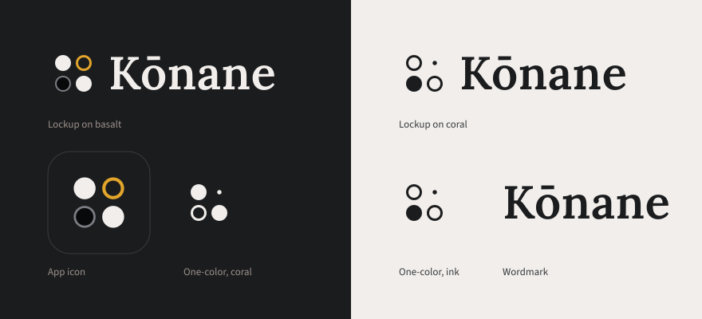

# Kōnane brand

How Kōnane looks, sounds, and talks about where the game comes from. Read this before changing UI text, colors, type, art, or anything a player sees.

| Document | Covers |
| --- | --- |
| [experience.md](experience.md) | What makes the app easy and fun for casual users |
| [voice.md](voice.md) | Tone, Hawaiian spelling, glossary, wording for the app's screens |
| [visual.md](visual.md) | Logo, color, type, iconography, imagery, and where each applies in the UI |
| [culture.md](culture.md) | What we say about Hawaiian culture, what we leave alone, and sources |
| [assets/](assets/) | Logo files, pattern, and reference boards |

## The brief

Four rules from the project owner. Everything else in this folder serves them.

1. The application is easy and fun to use for casual computer users and casual kōnane players.
2. The name is strictly **Kōnane**.
3. Colors, images, iconography, and typefaces are ones associated with Hawaiian culture.
4. No stereotypical images, such as palm trees, pineapples, and hula girls.

## Who it is for

Casual players who are curious about Hawaiian culture, and who are casual computer users too.

- Most have never played kōnane. Many found it through an interest in Hawaiʻi, not through board games.
- They play a game or two at a time, often against the computer.
- They want to learn the game quickly and trust that what they are shown is the real thing.
- They are comfortable clicking and reading. They are not comfortable with file paths, settings, or technical terms.
- They are not tournament players. Search depth, notation, and file formats are not why they came.

## The idea: bright moonlight

*Kōnane* has more than one meaning in the Pukui and Elbert dictionary. One is the game. Another is bright moonlight.

The brand is a board at night: black lava stone, white coral, and moonlight on basalt. The moon also gives the app its moments of delight, such as the full moon that rises on a win.

## Positioning

For people curious about Hawaiian culture, Kōnane is an easy, enjoyable way to play the Hawaiian game of lava stone and coral by its real rules, named in its own words.

## Principles

1. **Easy and fun.** One click starts a game. The screen always shows what you can do. Nothing needs a manual. See [experience.md](experience.md).
2. **The game comes first.** The rules in [rules.md](../../rules.md) are the product. The brand never bends them to look friendlier.
3. **Its own words.** The board is a papamū, the stones are ʻiliʻili, a hollow is a lua. Spell them correctly and explain each one once.
4. **Hawaiian sources.** Every color, image, icon, and typeface traces to something in Hawaiian culture or the islands themselves, and we can say what. See [visual.md](visual.md).
5. **No stereotypes.** Nothing from the postcard: no palm trees, pineapples, or hula girls. See [culture.md](culture.md#dont).

## Personality

| Kōnane is | Kōnane is not |
| --- | --- |
| Welcoming | Gushing or salesy |
| Playful | Childish or noisy |
| Easygoing | Slow or solemn |
| Grounded in real Hawaiian things | A tropical theme |
| Exact about the game and the language | Academic or lecturing |

## Name

- The name is **Kōnane**, with the kahakō, everywhere a person can read it: window title, screens, documents, store listings, images.
- Lowercase **kōnane** is the game itself, as in "a game of kōnane".
- Never "Konane", "KONANE", "Kō-nane", or "Hawaiian checkers".
- `konane` without the kahakō is allowed only where a machine requires it: the crate, the binary, file names, URLs.

## Lines

- **Descriptor:** The Hawaiian game of lava stone and coral.
- **Short line:** Play by moonlight.

The short line plays on the word's other meaning. It is not a claim about when the game was played. Do not build historical copy on it.

## Status

The app follows the visual identity and the wording. Some of [experience.md](experience.md) is not built yet: system file dialogs, named strength levels, a how-to-play screen, and sound. Each document ends with what differs.

The Hawaiian in these documents was checked against the Pukui and Elbert dictionary. It has not been reviewed by a fluent speaker. See [culture.md](culture.md#review).
