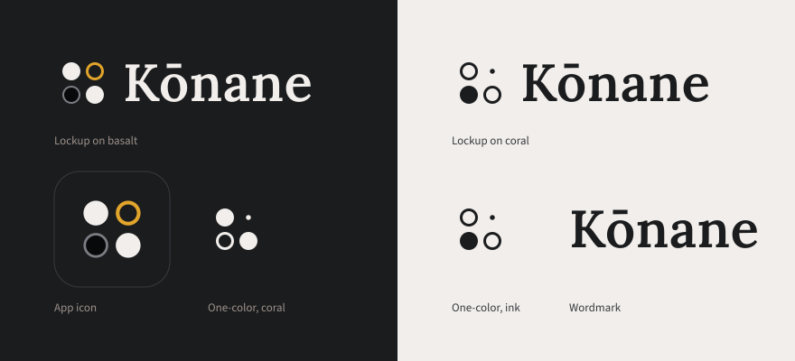
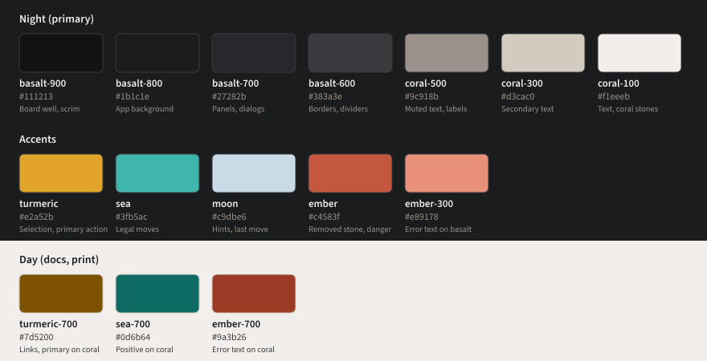
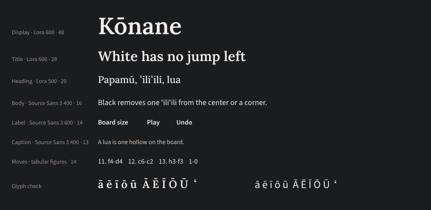
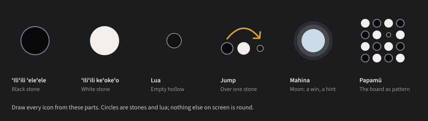

# Visual identity

The look comes from three things: black lava stone, white coral, and moonlight on basalt. The app is dark because the board is.

Every color, image, icon, and typeface here has a Hawaiian source, and each section names it. If you cannot name the source of something new, it does not belong.

## Logo

The mark is four lua just after Black's opening removal. The stone in the lower left is Black's, as a1 always is. The two coral stones sit on the other diagonal. The ring marks the lua Black has just emptied.

The wordmark is "Kōnane" set in Lora SemiBold and converted to outlines, so it needs no font.

| File | Use |
| --- | --- |
| [lockup-coral.svg](assets/lockup-coral.svg) | Mark and wordmark on basalt or other dark grounds. The default. |
| [lockup-ink.svg](assets/lockup-ink.svg) | Mark and wordmark on coral, white, or paper |
| [mark.svg](assets/mark.svg) | Full-color mark, dark grounds only |
| [mark-coral.svg](assets/mark-coral.svg) | One-color mark for dark grounds |
| [mark-ink.svg](assets/mark-ink.svg) | One-color mark for light grounds |
| [wordmark-coral.svg](assets/wordmark-coral.svg), [wordmark-ink.svg](assets/wordmark-ink.svg) | Wordmark alone |
| [app-icon.svg](assets/app-icon.svg), [app-icon-256.png](assets/app-icon-256.png) | Application and window icon |
| [pattern.svg](assets/pattern.svg) | Repeating background tile |

In the one-color marks, a filled disc is a stone in the ink color, a ring is a stone of the other color, and the small dot is the empty lua.

Rules:

- Keep clear space of one stone's diameter on every side.
- Smallest sizes: 16 px for the mark, 96 px wide for the lockup. Below 24 px use a one-color mark.
- The full-color mark goes on `basalt-900` through `basalt-700` only. On anything else use a one-color mark.
- Do not rotate or mirror the mark. Its orientation matches the board: a1 is at the lower left.
- Do not recolor the stones, add a fifth lua, add effects, or set the wordmark in another typeface.
- Do not retype the name beside the mark. Use a lockup file.

## Color

Night is the primary theme and the one the app uses. Day is for documents and print.

The basalt and coral values were sampled from the board and stone images in [data/](../../data/), so interface and art share one range.

### Neutrals

Basalt is pōhaku, the lava rock the islands are made of and the stone a papamū is cut from. Coral is koʻa, the white ʻiliʻili.

| Token | Hex | Use |
| --- | --- | --- |
| `basalt-900` | `#111213` | Board well, scrim behind dialogs |
| `basalt-800` | `#1b1c1e` | App background |
| `basalt-700` | `#27282b` | Panels, dialogs, the move list |
| `basalt-600` | `#383a3e` | Dividers and decorative borders. Too faint for control borders. |
| `coral-500` | `#9c918b` | Muted text, coordinate labels, control borders |
| `coral-300` | `#d3cac0` | Secondary text |
| `coral-100` | `#f1eeeb` | Primary text |

### Accents

| Token | Hex | Hawaiian source | Use |
| --- | --- | --- | --- |
| `turmeric` | `#e2a52b` | ʻŌlena, the turmeric used to color cloth and kapa yellow | The selected stone, the primary button, keyboard focus |
| `sea` | `#3fb5ac` | Kai, the sea over a sand and coral bottom | Legal moves: lua you may land in, stones you may remove |
| `moon` | `#c9dbe6` | Mahina, the moon, and the name's second meaning | Quiet hints: stones that can move, the last move |
| `ember` | `#c4583f` | Lava as it cools to stone | A removed stone, destructive actions. Graphics only. |
| `ember-300` | `#e89178` | A lighter ember | Error text on basalt |

Day equivalents for text on `coral-100`: `turmeric-700` `#7d5200`, `sea-700` `#0d6b64`, `ember-700` `#9a3b26`. Body text on Day is `basalt-800`.

### Contrast

| Pair | Ratio |
| --- | --- |
| `coral-100` on `basalt-800` | 14.8 |
| `coral-300` on `basalt-800` | 10.5 |
| `coral-500` on `basalt-800` | 5.6 |
| `coral-500` on `basalt-700` | 4.8 |
| `turmeric` on `basalt-800`, and `basalt-800` on `turmeric` | 7.8 |
| `sea` on `basalt-800` | 6.8 |
| `moon` on `basalt-800` | 12.0 |
| `ember` on `basalt-800` | 3.9 |
| `ember-300` on `basalt-800` | 7.1 |
| `turmeric-700`, `sea-700`, `ember-700` on `coral-100` | 5.9, 5.5, 6.0 |

Rules:

- Text needs 4.5:1. Rings, borders, and icons need 3:1. `ember` passes only the second, so never set text in it.
- Text on a `turmeric` button is `basalt-800`.
- One `turmeric` element per screen: the thing the player should act on.
- Never signal with color alone. A selection is a heavier ring, a legal landing is a filled disc, a hint is a thin ring.
- Do not add hues. No green, no purple, no gradients.

## Typography

| Role | Typeface | Weight | Size |
| --- | --- | --- | --- |
| Display | Lora | 600 | 48 |
| Title | Lora | 600 | 28 |
| Heading | Lora | 500 | 20 |
| Body, status line | Source Sans 3 | 400 | 16 |
| Button, label | Source Sans 3 | 600 | 14 |
| Caption | Source Sans 3 | 400 | 13 |
| Move list | Source Sans 3 | 400 | 14, tabular figures |

No typeface is Hawaiian in itself, and the ones sold as "Hawaiian" or "tiki" are the stereotype this brand avoids. The Hawaiian source for type is the language in print. Hawaiian-language newspapers ran from 1834 to 1948, set in the book and news types of their day, and modern Hawaiian is written with the ʻokina and kahakō. So the brand uses a bookish serif and a plain sans, and requires both to draw every Hawaiian letter correctly.

- Lora is for names and moments: the title, a result, a section heading. Source Sans 3 is for everything a player reads to act.
- Both are licensed under the SIL Open Font License 1.1 and are available from Google Fonts.
- Both were checked to contain ā ē ī ō ū, Ā Ē Ī Ō Ū, and the ʻokina (U+02BB), and to space the ʻokina correctly.
- Bundle the font files in the binary, as the stone images are, so the app looks the same on every machine.
- Check any new typeface for U+02BB before adopting it. Many popular faces lack it, among them Jost, Outfit, Figtree, Rubik, DM Sans, Manrope, and Fraunces. Young Serif has it but spaces it badly.
- No all-caps Hawaiian words. Capitals make the kahakō and ʻokina harder to read.
- Left-align running text. Center only the setup and game-over panels.

## Iconography

Icons come from the game and from the moon. There is no general-purpose icon set.

| Motif | Meaning | Use |
| --- | --- | --- |
| ʻIliʻili ʻeleʻele | Black's stone | Player labels, the move list, whose turn it is |
| ʻIliʻili keʻokeʻo | White's stone | The same |
| Lua | An empty hollow | Empty states, the opening removal |
| Jump | One stone over another | How-to-play, hints |
| Mahina | The moon | A win, a hint, the computer thinking |
| Papamū | The board | Pattern and backgrounds |

- Label every button with words. An icon may sit beside a label and never replaces one.
- Draw new icons from these parts with a 2 px line and round ends.
- The moon is always full or plainly crescent. Do not use named moon phases without a reviewer.

### Pattern

[pattern.svg](assets/pattern.svg) repeats the board's opening position at low contrast. Use it behind the setup screen and in empty areas, never behind text smaller than 20 px.

The pattern is the board itself. Pukui and Elbert also record *kōnane* as the name of a kapa-beater design. This pattern does not copy that design or any other kapa pattern.

## Shape and motion

- Circles belong to the board: stones, lua, rings. Do not use circles for buttons or avatars.
- Corner radius is 6 px on buttons and inputs, 12 px on dialogs.
- Rings are 2 px for hints and 3 px for the selection.
- A removed stone fades out over 300 ms. Other transitions match it: fades between 150 and 300 ms, with no bounce, spin, or confetti.

## Imagery

- Photographs of the real things: lava stone, coral, pitted basalt. The images in [data/](../../data/) set the standard.
- Other materials that fit: wood, because the board was made of stone or wood; the sea; the moon.
- If a setting is needed, show the Hawaiian shore and its rock, not a resort. No palm trees, pineapples, or hula girls. The full list is in [culture.md](culture.md#dont).
- Shoot or render from directly above, as a player sees the board.
- Light comes low from one side, cool and soft, like moonlight.
- Stones vary. Use several stone images on a board so it does not look stamped.
- No cartoon or clip-art styles, and no drawn icons standing in for stones on the board.

## In the app

Where the app differs from this guide today.

| Element | Location | Current | Brand |
| --- | --- | --- | --- |
| Theme | [src/main.rs](../../src/main.rs) | iced default | Custom palette: background `basalt-800`, text `coral-100`, primary `turmeric`, success `sea`, warning `turmeric`, danger `ember` |
| Font | [src/main.rs](../../src/main.rs) | System default | Source Sans 3, with Lora for the title and results |
| Window icon | [src/main.rs](../../src/main.rs) | None | `app-icon-256.png` |
| Coordinate labels | [src/ui/board_view.rs](../../src/ui/board_view.rs) | Gray `(0.3, 0.3, 0.3)` | `coral-500` |
| Stones that may be removed | [src/ui/board_view.rs](../../src/ui/board_view.rs) | Green ring, 3 px | `sea` ring, 2 px |
| Stones that can move | [src/ui/board_view.rs](../../src/ui/board_view.rs) | Blue ring, 2 px | `moon` ring, 2 px |
| Selected stone | [src/ui/board_view.rs](../../src/ui/board_view.rs) | Yellow ring, 3 px | `turmeric` ring, 3 px |
| Lua the stone may land in | [src/ui/board_view.rs](../../src/ui/board_view.rs) | Green fill at 30% with green ring | `sea` fill at 30% with `sea` ring, 2 px |
| Dialog scrim | [src/ui/setup_view.rs](../../src/ui/setup_view.rs), [src/ui/game_over_view.rs](../../src/ui/game_over_view.rs) | Black at 40–60% | `basalt-900` at 60% |
| Dialog panel | [src/ui/setup_view.rs](../../src/ui/setup_view.rs), [src/ui/game_over_view.rs](../../src/ui/game_over_view.rs) | Theme background | `basalt-700`, 12 px radius |
| Stones | [src/ui/board_view.rs](../../src/ui/board_view.rs) | One lava stone image and one coral image | Several of each, so stones differ |
| Board | [src/ui/board_view.rs](../../src/ui/board_view.rs) | Basalt image | No change |
| Setup background | [src/ui/setup_view.rs](../../src/ui/setup_view.rs) | Plain | `pattern.svg` |

For iced, `sea` is `Color::from_rgb8(0x3f, 0xb5, 0xac)`, and so on for the other tokens.
